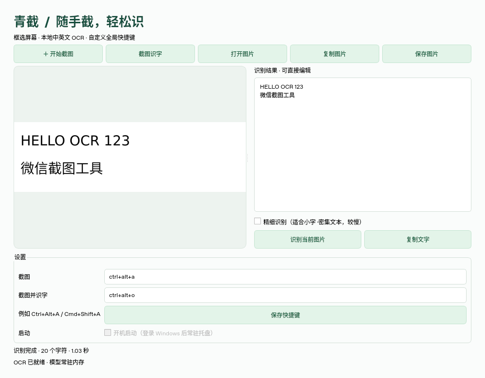
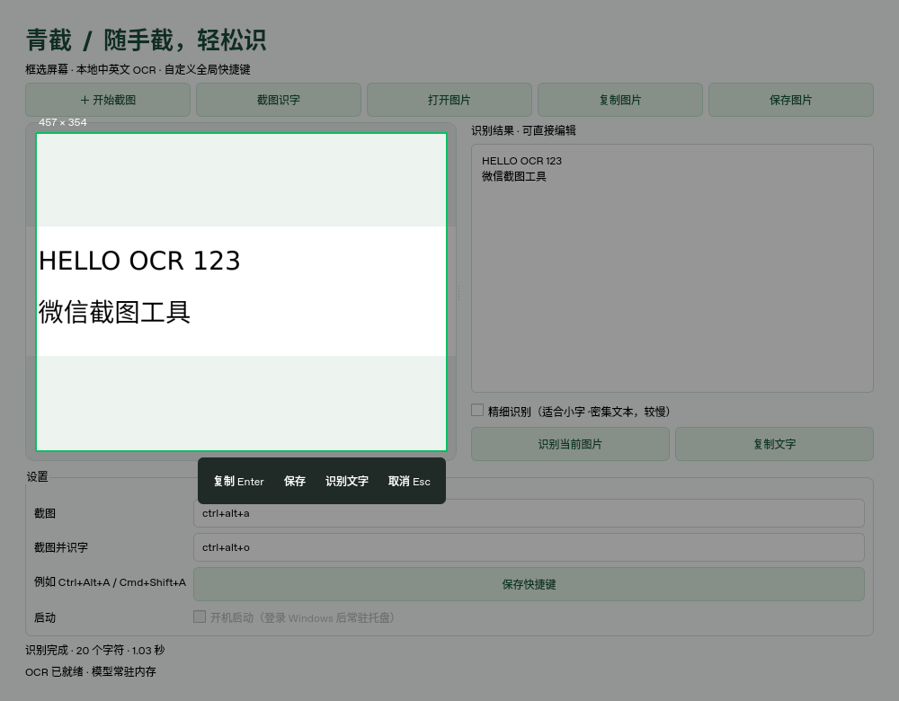
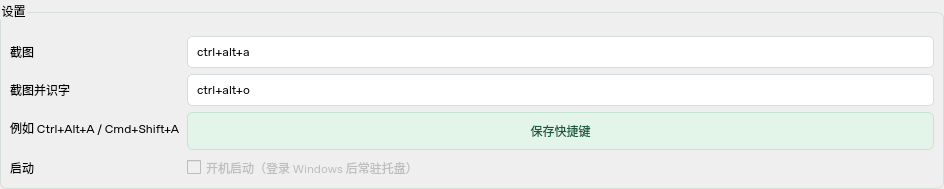
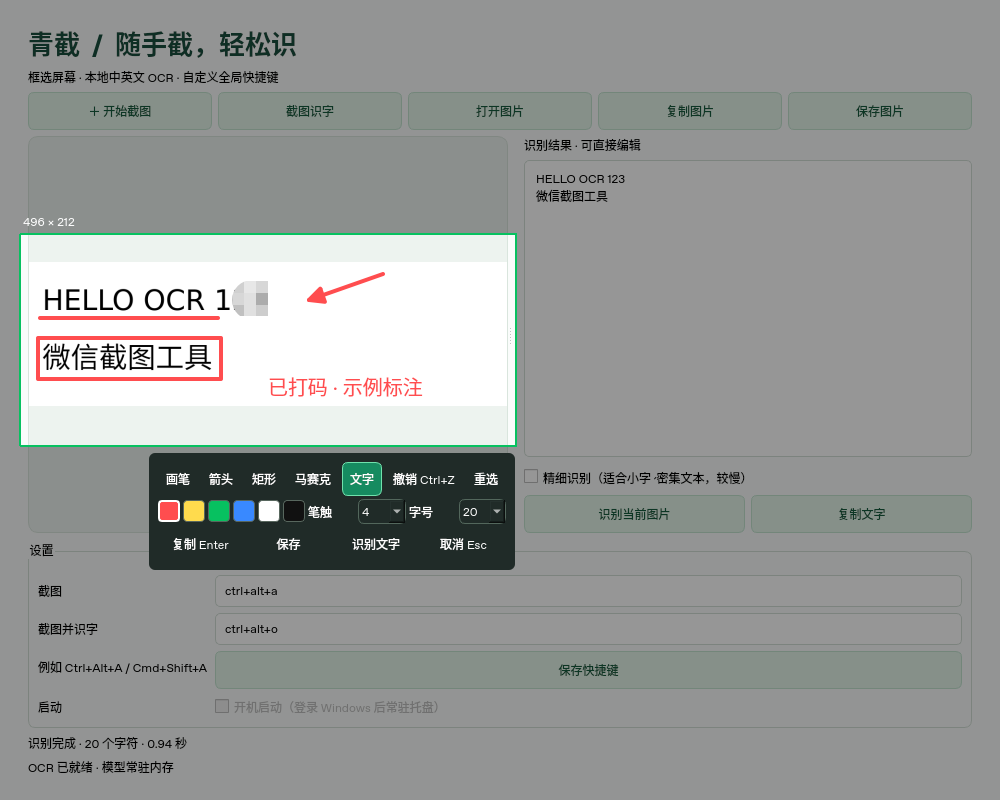
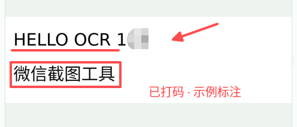

# 青截 WX_OCR

类似微信操作方式的桌面截图工具：拖动框选、复制到剪贴板、保存 PNG、本地中英文 OCR、全局快捷键和系统托盘。

## 下载 Windows 版

已发布版本请前往 [GitHub Releases](https://github.com/ksharpdabu/WX_OCR/releases/latest) 下载带版本号的 Windows 64 位程序，无需安装 Python：

- `QingJie-v0.3.0-Windows-x64.exe`：单文件版，直接双击运行；启动时会解包运行库。
- `QingJie-v0.3.0-Windows-x64-portable.zip`：推荐日常使用，完整解压后运行 `QingJie.exe`，保留 `_internal` 文件夹。

更新前请从托盘退出旧版；移动目录后重新设置“开机启动”。仓库目前为私有，下载需有访问权限。Release 附有 SHA256 校验文件和自检报告。

## 效果截图

以下为程序实际运行界面的离屏截图；Linux 下“开机启动”置灰，Windows 下可勾选。

**中英文 OCR 识别**：左侧预览原图，右侧编辑、复制识别结果，下方显示实际耗时。



**框选截图**：拖动选择区域后，可复制、保存或识别文字，支持 Enter / Esc。



**设置**：自定义全局快捷键，开启或关闭 Windows 登录启动。



## 安装运行

推荐 Python 3.11 或 3.12（64 位），在**自己的桌面电脑**运行：

```bash
python -m venv .venv
```

Windows PowerShell 激活：`.venv\Scripts\Activate.ps1`；macOS / Linux 激活：`source .venv/bin/activate`。

```bash
python -m pip install -r requirements.txt
python main.py
```

默认快捷键：`Ctrl+Alt+A` 截图，`Ctrl+Alt+O` 框选后直接识字。在主窗口输入新组合并点击“保存快捷键”，立即替换旧绑定，并在下次启动时恢复。支持 Ctrl、Alt、Shift、Cmd 加字母、数字或 F1–F12，例如 macOS 可设 `Cmd+Shift+A`。两个功能不可使用相同组合。

## 使用

- 按快捷键或点击“开始截图”，在鼠标所在屏幕拖动框选区域。多显示器时先把鼠标移到目标屏幕；暂不支持跨屏框选。
- 框选后可选择画笔、箭头、矩形、马赛克或文字进行标注；支持颜色、笔触粗细和字号调整。点击“重选”重新框选，会清除当前标注。
- 马赛克用鼠标按住涂抹；文字工具单击选区内输入文字，Enter 确认文字，Esc 放弃当前输入。点击“撤销”或 Ctrl+Z 撤销上一步标注。
- 点击工具栏复制、保存或识别文字，都会使用标注后的图片；Enter 复制，Esc / 右键取消整个截图。
- “截图识字”会在框选完成后自动识别；也可以打开现有图片。结果可编辑、复制。
- OCR 在后台运行，使用 RapidOCR 自带的中英文 ONNX 模型，无需 API Key；正常安装后识别不需要网络，不上传图片。不自动保存截图或识别历史。
- 有托盘的系统中，关闭窗口会常驻托盘；托盘菜单“退出”完全结束。没有托盘时关闭窗口直接退出。尚未支持滚动长截图。

## 截图标注（0.4.0）

普通截图框选后可继续编辑：画笔手绘、箭头、矩形、鼠标涂抹马赛克、文字。颜色、笔触和字号可在工具栏调整；支持逐步撤销。文字输入中的 Enter 只确认文字，再按 Enter 才复制截图。小选区的文字会自动换行，并裁剪到选区边界。

标注会合成为最终图片像素，复制、PNG 保存和 OCR 使用同一张结果图，马赛克不会作为可移除的图层保留在导出文件中。高分屏截图按实际像素导出，标注位置与预览一致。

“截图识字”快捷键依然在框选后立即识别；需要先标注再识别时，请使用普通截图，再点击工具栏“识别文字”。



导出的最终图片（含马赛克和文字，未包含工具栏或选区边框）：



## 开机启动（Windows）

在主窗口“设置”中勾选“开机启动”，立即注册当前用户的启动项，无需管理员权限。取消勾选即可移除。首次运行默认关闭，界面每次从 Windows 注册表读取实际状态，不会仅保存一个无效的勾选标记。系统拒绝操作时会提示失败并恢复勾选状态。

下次登录 Windows 后，程序会后台启动并常驻托盘，不弹出主窗口；双击托盘图标可打开。若托盘不可用，会显示主窗口。手动双击程序仍正常显示窗口。便携版需保留程序目录；移动目录后请取消再重新勾选，使启动路径更新。Windows“启动应用”中的系统禁用策略仍会影响是否实际启动。macOS/Linux 上该选项置灰。

## 识别性能

启动后会在后台加载和预热 OCR，界面显示“OCR 已就绪”后即可使用。模型常驻内存，默认模式避免把小截图一律放大到短边 736 像素，ONNX 推理线程也作了限制。保留原有中英文模型和方向识别。对很小或密集的文字，可勾选“精细识别”恢复放大检测；该模式较慢。界面显示每次从点击到完成的实际耗时。速度依图片和硬件而变，未与微信作同机对比。

Windows 打包流程会比较旧版/优化版在相同中英文图片上的预热后耗时，并检查文字未丢失。报告随便携包提供；这组样例不代表所有截图或所有电脑。

## 系统说明

- **Windows**：建议 Windows 10/11。若其他应用以管理员运行，快捷键可能需要同等权限。被占用的组合可能无法触发，请换一个组合；监听启动成功不代表系统保证独占该组合。
- **macOS**：给启动程序（终端、Python 或打包后的应用）授予“屏幕录制”“辅助功能”，必要时授予“输入监控”权限，并重新启动应用。
- **Linux**：建议 X11。Wayland 的全局按键和直接屏幕读取通常受限，本项目未实现 portal 截图；出现问题请切换 X11 会话。某些发行版需要安装 Qt xcb 所需的系统库。
- 支持按屏幕像素比例裁剪高分屏截图；没有真实桌面的云端无法完成系统截图与全局按键的端到端验证。
- 快捷键设置使用 Qt QSettings 存储在当前用户配置中。OCR 正在运行时暂时禁止换图或再次截图，避免结果与图片错配。

## 打包为桌面程序

在目标操作系统中执行（Windows 的 exe 必须在 Windows 上打包）：

```bash
python -m pip install pyinstaller
python -m PyInstaller --noconfirm --windowed --name QingJie --collect-all rapidocr_onnxruntime --collect-all onnxruntime --collect-submodules pynput --add-data "wxocr/assets:wxocr/assets" main.py
```

产物在 `dist/QingJie/`，需分发整个文件夹；包括 OCR 模型，体积较大。Windows 便携包已通过构建与自检；尚未提供签名的 Windows/macOS 安装程序。

## 验证

```bash
python -m pip install pytest
QT_QPA_PLATFORM=offscreen python -m pytest -q
```

Windows PowerShell 请先执行 `$env:QT_QPA_PLATFORM="offscreen"`，再执行 `python -m pytest -q`。
